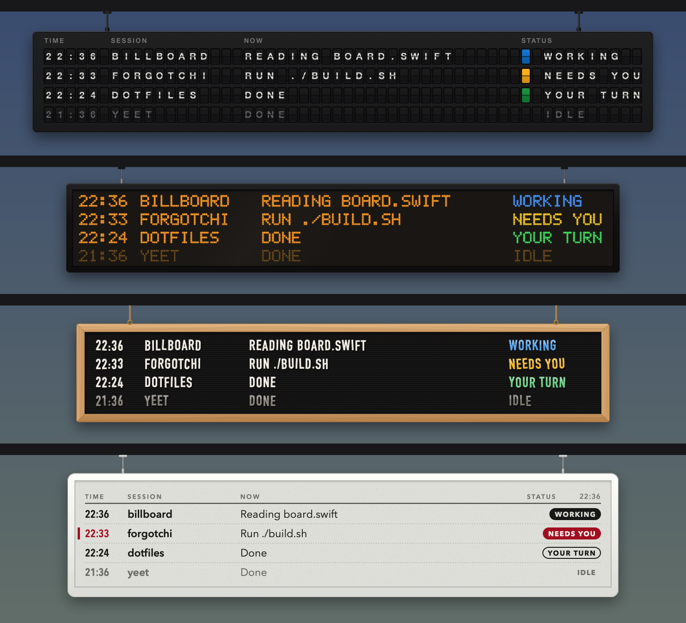

# Billboard

**Now boarding: every Claude Code session you forgot you started.**

You have seven terminal tabs open. One of them has been politely waiting forty minutes for you to click "Allow". Another finished an hour ago and has been staring into the void ever since. You don't know which. Nobody knows which.

Billboard is a tiny departures board that hangs from your Mac's menu bar and tells you, in big honest letters, what every Claude session is doing. Like an airport, but the flights are refactors and the delays are your fault.



## Reading the board

| Column  | Translation |
|---------|-------------|
| TIME    | When this state began. Big number in the past + YOUR TURN = you've been ghosting your AI. |
| SESSION | The project folder, or the session's title if the folder is useless (looking at you, `~/Downloads`). |
| NOW     | What it's doing: `Editing main.swift`, `Running the tests`, `Thinking` (same as you, but faster). |
| STATUS  | See below. |

| Status | Colour | Meaning |
|--------|--------|---------|
| **WORKING** | blue | On time. Doing your job for you. Don't interrupt. |
| **NEEDS YOU** | yellow, blinking/flapping/wiggling | Gate hold. It wants permission or has a question. It will wait forever. It's very polite. Don't test it. |
| **YOUR TURN** | green | Landed. Baggage on carousel 3. Go read what it did. |
| **ERROR** | red | Cancelled. Probably the API, probably not your fault. Probably. |
| **IDLE** | grey | Finished 15+ minutes ago and has stopped expecting anything from you. |

When a session ends, its row departs. When your mouse goes over the board, it fades away so you can click whatever was underneath. It's a board, not a hostage situation.

## Pick your terminal

Click the 🚊 tram in the menu bar → **Theme**:

- **Flipboard**: a Vestaboard-style split-flap board. Letters clatter through the drum when anything changes. Turn on Flap Sound if your coworkers deserve it.
- **LED Sign**: an amber dot-matrix bus sign. Long text scrolls like a ticker. Gives "last bus to Refactorville" energy.
- **Letterboard**: white plastic letters on black felt in an oak frame. Letters drop into the grooves a little crooked, like a café menu. NEEDS YOU makes the letters wiggle, which is the most passive-aggressive thing a letter can do.
- **E-Ink**: a calm black/white/red e-paper sign, like a meeting-room display. Changes do the e-paper flash and leave a ghost of the old text, because it's haunted by your unfinished tasks.

The same menu also has max rows, size, left/center/right position, hide-when-empty, and Flap Sound (off by default, for the sake of open-plan offices everywhere).

## Install with a prompt

You have an AI that can use a terminal. Make it install its own surveillance board. Paste this into Claude Code:

```text
Install Billboard (https://github.com/pratikaman/billboard) on this Mac:

1. Clone the repo to ~/billboard and run ./build.sh there. It needs the Xcode Command Line Tools;
   if swiftc is missing, tell me to run `xcode-select --install` and stop.
2. Run ./install-hooks.py in ~/billboard. It backs up each Claude Code settings.json it finds
   (~/.claude, and $CLAUDE_CONFIG_DIR if I use one) and ADDS Billboard's hook next to my existing
   hooks. Afterwards, check every settings.json it touched is still valid JSON and that my other
   hooks are still there.
3. Run: open ~/billboard/Billboard.app
4. Tell me to look just under my menu bar.
```

Sessions that are already open check in the next time they do something. If a session never shows up, restart it so it reloads its hooks.

## Install like it's 2019

```sh
git clone https://github.com/pratikaman/billboard.git ~/billboard
cd ~/billboard
./build.sh            # builds Billboard.app and bin/billboard-hook
./install-hooks.py    # adds the hook to ~/.claude (and $CLAUDE_CONFIG_DIR if set), backs up first
open Billboard.app
```

Needs macOS 14+, the Swift toolchain (Xcode or Command Line Tools), python3 (for the installer), and Claude Code. To start it at login, add `Billboard.app` under System Settings → General → Login Items.

## Uninstall

All flights cancelled. Paste into Claude Code:

```text
Run ~/billboard/install-hooks.py --uninstall, quit Billboard from its tram menu-bar icon,
and delete ~/billboard.
```

Or by hand: `./install-hooks.py --uninstall`, then 🚊 → **Quit Billboard**.

## How it works

- **The hook.** `bin/billboard-hook` is a tiny Swift binary (~10 ms, so your tools don't notice). Claude Code calls it on `SessionStart`, `UserPromptSubmit`, `PreToolUse`, `PostToolUse(Failure)`, `Notification`, `Stop(Failure)` and `SessionEnd`. It writes one small JSON file per session to `/tmp/claude-billboard/` with the state, a one-line activity, the folder, and the PID of the `claude` process.
- **The app.** `Billboard.app` reads that folder twice a second. It also skims each session's transcript for its AI-written title and for `[Request interrupted by user]`, because pressing Esc has no hook. Rows whose `claude` process has died are removed.
- **Privacy.** Nothing leaves your Mac. The only thing tracking you is your own guilt about that yellow row.

## Known delays

- Right after you click "Allow", the row can stay on NEEDS YOU until that tool call finishes. Claude Code has no "permission granted" hook, so the board can't know.
- A theme might be judging you. That's a feature.

## Development

```sh
./build.sh
# render a theme to PNG without opening a window:
Billboard.app/Contents/MacOS/Billboard --snapshot out.png --theme led --needs
Billboard.app/Contents/MacOS/Billboard --snapshot out.png --theme letter --at 0.3   # 0.3 s into a change
# fake sessions on the live board:
Billboard.app/Contents/MacOS/Billboard --demo
```

`Sources/hook` is the hook. In `Sources/app`, `Sessions.swift` reads the state, `Themes.swift` defines the theme protocol, each theme has its own file, and `main.swift` holds the panel, menu and preferences.
